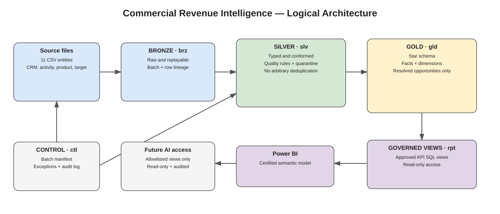

# Commercial Revenue Intelligence Data Warehouse

A SQL-first analytics engineering project that turns CRM sales data into a governed commercial KPI layer for revenue performance, pipeline management, target attainment, lead conversion, sales activity and product-line analysis. The final layer exposes approved business-named SQL views for BI tools and a constrained AI-query prototype.

## Business problem

This project develops a CRM-based commercial intelligence foundation that consolidates sales opportunities, leads, activities, products, accounts, sales representatives, and targets into a structured analytical data warehouse.

It establishes consistent definitions for won revenue, open pipeline, weighted pipeline, win rate, lead conversion, sales activity, and target attainment. Data-quality controls flag conflicting opportunity records rather than silently counting them, while reusable reporting views provide a consistent starting point for BI reporting and future AI-assisted analysis.

### Technical overview

Technical architecture

1. Source and ingestion
11 CRM-related CSV entities covering opportunities, leads, activities, products, accounts, contacts, sales representatives, campaigns, dates, and targets.

2. Data quality and transformation
Type standardization, required-field checks, business-rule validation, target reconciliation, and quarantine for conflicting opportunity records.

3. Dimensional warehouse
SQL Server Bronze, Silver, and Gold layers with fact tables for opportunities, leads, activities, product lines, and sales targets, supported by shared dimensions.

4. Commercial KPI layer
Reusable SQL views for won revenue, open and weighted pipeline, win rate, target achievement, opportunity ageing, lead conversion, sales activity, and product-line margin.

5. Governed AI-ready access
Business-named views, KPI definitions, natural-language question examples, parameterized query intents, and a least-privilege permissions design.

Technical stack: SQL Server, T-SQL, Python, CSV data processing, dimensional data modeling, data-quality validation, commercial KPI engineering, and AI-ready query governance.

## Architecture



The pipeline is **CSV source → Bronze raw landing (`brz`) → Silver typed/validated tables (`slv`) → Gold dimensional model (`gld`) → KPI views (`rpt`) → approved AI-facing views (`rpt.ai_*`)**. Control/audit tables live in `ctl`.

More diagrams: [data flow SVG](docs/images/data_flow.svg) · [editable architecture diagram](architecture/commercial_revenue_intelligence_architecture.drawio) · [editable data-flow diagram](architecture/data_flow.drawio).

## What is included

| Area | Deliverable |
|---|---|
| Source profiling | Profiles, anomaly extracts, relationship review and documented assumptions under `profiling/` |
| Bronze ingestion | Raw SQL tables, batch/audit controls, Python CSV loader and manifest |
| Silver transformations | Typed tables, transformations for all 11 entities, data-quality checks and quarantine logic |
| Gold model | Dimensional model with six dimensions and five fact tables, load procedure and reconciliation checks |
| Commercial analytics | Reusable SQL KPI views, glossary and management query examples |
| AI-ready access | Nine approved business views, registry, natural-language examples, role template and constrained query prototype |
| Project evidence | Offline validation JSON, unit-test matrix, source-level KPI answers, data dictionary and implementation runbook |
| Storytelling | Industry use case study in `docs/stories/` |

## Source data and data dictionary

The `data/sample/` folder contains the 11 core CSV data extracted from Microsoft Dynamics 365 CRM plus source dictionary and dataset summary. The 11 core entities total **93,837 rows**:

| Entity | Rows | Intended grain |
|---|---:|---|
| Accounts | 500 | One row per account |
| Activities | 40,000 | One row per activity |
| Campaigns | 30 | One row per campaign |
| Contacts | 1,500 | One row per contact |
| Date | 1,096 | One row per calendar date |
| Leads | 5,000 | One row per lead |
| Opportunities | 15,000 | One source row per opportunity record |
| OpportunityProducts | 28,911 | Source product-line row |
| Products | 100 | One row per product |
| SalesReps | 50 | One row per sales representative |
| Targets | 1,650 | One row per month × sales representative |

- [Readable data dictionary](docs/data_dictionary.md)
- [Column-level dictionary CSV](docs/data_dictionary.csv)
- [Source-to-target mapping draft](docs/source_to_target_mapping_draft.csv)
- [Business requirements and KPI glossary](docs/business_requirements_and_kpi_glossary.md)

## Key data-quality decisions

1. **Conflicting opportunity duplicates:** 35 `OpportunityID` values occur in conflicting duplicate records (70 rows). All 70 rows are quarantined/excluded from opportunity-based source-level KPI answers until a data owner approves a canonical record. Never arbitrarily keep the first row.
2. **Repeated opportunity-product pairs:** 203 `(OpportunityID, ProductID)` pairs repeat (406 rows). Preserve them; there is no stable source line ID, and the pair is not assumed unique.
3. **Revenue contract:** `EstimatedRevenue` is the selected won-revenue basis for `Closed Won` opportunities. Product `LineRevenue` is a separate, provisional measure.
4. **Stage contract:** open stages are Qualification, Needs Analysis, Proposal and Negotiation; closed outcomes are Closed Won and Closed Lost. `Unknown` is excluded from trusted stage KPIs.
5. **Currency:** amounts are in AED.
6. **Targets:** monthly targets are unique by Month + SalesRepID. The supplied target calendar runs through September 2026; 2026 target comparisons are therefore Jan–Sep only.
7. **Forecast limitations:** current-state opportunity rows do not provide historical snapshots, so forecast backtesting or historical close-date slippage cannot be claimed.
8. **Fanout:** do not sum opportunity, activity and product-line measures after a raw many-to-many join. Aggregate facts to a common grain first.

## Quick start

### 1. Requirements

- Python 3.10+
- SQL Server 2019+ (or a compatible supported SQL Server version) for database execution
- Microsoft ODBC Driver 18 for SQL Server for Python connectivity
- SQL Server Management Studio or `sqlcmd`
- Git

### 2. Clone and install

```bash
git clone https://github.com/<your-user>/commercial-revenue-intelligence-data-warehouse.git
cd commercial-revenue-intelligence-data-warehouse
python -m venv .venv
# Windows PowerShell: .venv\Scripts\Activate.ps1
# macOS/Linux: source .venv/bin/activate
python -m pip install --upgrade pip
pip install -r requirements.txt
```

### 3. Run offline source validation (no SQL Server needed)

```bash
python src/validation/validate_phase4_sources.py --source-dir data/sample --out docs/evidence/phase8_offline_source_validation.json
python src/analysis/build_business_answers.py --data-dir data/sample --out-dir docs/evidence --as-of 2026-10-17
python -m unittest discover -s tests -v
python -m py_compile src/ingestion/load_bronze.py src/validation/validate_phase4_sources.py src/ai_access/governed_query_demo.py src/analysis/build_business_answers.py
```

The source validation checks exact headers, row widths, source row counts, duplicate opportunity IDs, repeated opportunity-product pairs and target grain. The KPI snapshot script is an independent source-level calculation; it is not a substitute for executing the SQL views.

### 4. Create a test database and run SQL scripts

Create an empty SQL Server database named `CommercialRevenueIntelligence` (or update the connection settings). Run these scripts in order in the same database:

1. `sql/00_admin/010_create_schemas.sql`
2. `sql/00_admin/020_create_control_tables.sql`
3. `sql/00_admin/030_ingestion_procedures.sql`
4. `sql/01_bronze/100_create_bronze_tables.sql`
5. `sql/02_silver/100_create_silver_tables.sql`
6. `sql/02_silver/110_transform_opportunities_and_targets.sql` (procedure definition)
7. `sql/02_silver/120_create_remaining_silver_tables.sql`
8. `sql/02_silver/130_transform_remaining_entities.sql` (procedure definition)
9. `sql/03_gold/100_create_gold_tables.sql`
10. `sql/03_gold/110_load_gold.sql` (procedure definition)
11. `sql/03_gold/200_gold_relationship_and_aggregation_checks.sql` after loading
12. `sql/04_quality/200_silver_quality_checks.sql` and `sql/04_quality/210_phase4_full_reconciliation.sql` after Silver transformations
13. `sql/05_analytics/100_create_commercial_kpi_views.sql`
14. `sql/05_analytics/200_phase6_definition_and_edge_case_tests.sql`
15. `sql/06_ai_access/100_create_ai_business_views.sql`
16. Review and adapt `sql/06_ai_access/110_ai_access_permissions.sql` for a dedicated least-privilege database principal, then run `sql/06_ai_access/200_ai_access_smoke_tests.sql` under that principal.

**Execution notes:** stored procedure definition scripts do not themselves execute transformations. Follow the specific `EXEC` instructions in the corresponding phase documentation and procedure signatures. Run first in a disposable test database, inspect procedure parameters, and capture actual result sets. 

### 5. Load CSVs into Bronze

Set a connection string in your shell; do not commit credentials:

```powershell
$env:WAREHOUSE_SQL_CONNECTION = 'DRIVER={ODBC Driver 18 for SQL Server};SERVER=localhost;DATABASE=CommercialRevenueIntelligence;Trusted_Connection=yes;TrustServerCertificate=yes'
python src/ingestion/load_bronze.py --source-dir data/sample --dry-run
python src/ingestion/load_bronze.py --source-dir data/sample
```

Use an appropriate authenticated SQL Server connection in your environment. The loader is append-only by ingestion batch; repeated runs add new batches rather than replacing prior data. Review `docs/phase3_bronze_ingestion.md` before loading.

### 6. Run Silver, Gold and reporting layers

Use the stored procedure signatures documented in the SQL scripts and phase docs. The expected sequence is: ingest Bronze → run Silver transformations → run Silver quality/reconciliation checks → run Gold load → run Gold relationship checks → create KPI views → execute Phase 6 tests → create AI views → verify permissions and smoke tests. Do not publish KPI numbers until runtime checks pass.

### 7. Try the governed query prototype

```bash
python src/ai_access/governed_query_demo.py --list
python src/ai_access/governed_query_demo.py --intent open_pipeline --region North --limit 20
```

Without `WAREHOUSE_SQL_CONNECTION`, the script prints an **EXPLAIN ONLY** plan and does not query a database. To execute, install `pyodbc` and the SQL Server ODBC driver, configure a read-only connection, and use an approved intent. The adapter uses fixed allowlisted query templates and parameterized inputs; it does not accept arbitrary SQL and does not call an LLM. A separate LLM-to-intent classifier is future work.

## Commercial KPI answers (illustrative source-level results)

The reproducible calculations are in [`docs/evidence/commercial_kpi_snapshot.md`](docs/evidence/commercial_kpi_snapshot.md), with CSV/JSON outputs alongside it. The snapshot excludes all 70 rows associated with conflicting duplicate opportunity IDs.

Selected results from the supplied sample dataset:

- **Open pipeline:** approximately AED 442.8m across 10,128 eligible open opportunities.
- **Weighted open pipeline:** approximately AED 182.3m using stored probabilities.
- **Past expected close:** 10,010 open opportunities / approximately AED 437.6m pipeline as of 17 October 2026; a current-state alert, not proof of historical slippage.
- **Lead status conversion:** 1,394 / 5,000 leads = 27.88%; no lead-to-opportunity bridge exists.
- **2026 target attainment:** 62.30% across January–September 2026 target months; do not compare with a full-year target.


## Validation evidence and status

| Validation area | Status | Evidence |
|---|---|---|
| Source file contract | **PASS** | [`phase8_offline_source_validation.json`](docs/evidence/phase8_offline_source_validation.json) |
| Source row count | **PASS** — 93,837 expected and observed | Same JSON report |
| Duplicate and repeated-pair anomaly detection | **PASS** — 35 conflicting opportunity IDs; 203 repeated product pairs | Same JSON report and `profiling/` |
| Target grain | **PASS** — no duplicate Month + SalesRepID grain | Same JSON report |
| Python unit tests | See [`phase8_test_matrix.md`](docs/evidence/phase8_test_matrix.md) | Local tests cover source contracts and business rules |
| Python syntax / AI prototype explain-only | Local check only | Run commands above; no LLM or DB call |
| SQL Server DDL / transformations / KPI views | **Completed Runtime** | Must be executed in a configured SQL Server environment |
| Least-privilege permission denial tests | **Completed Runtime** | Test under a dedicated restricted SQL principal |
| LLM integration / intent classification | **NOT IMPLEMENTED** | Prototype is fixed-intent query adapter only |

## Repository map

```text
commercial_revenue_intelligence_warehouse/
├── README.md
├── architecture/                 # editable Draw.io + SVG architecture/data flow
├── data/sample/                  # CRM CSV inputs
├── docs/
│   ├── ai_access/                # view registry, questions, governance
│   ├── decisions/                # architecture decision register
│   ├── evidence/                 # data checks, test matrix, KPI results
│   ├── images/                   # README-renderable architecture SVGs
│   ├── runbooks/                 # setup / execution notes
│   ├── stories/                  # LinkedIn and Medium drafts
│   ├── data_dictionary.*
│   └── phase*.md                 # phase implementation notes
├── profiling/                    # generated profiles and anomaly extracts
├── sql/
│   ├── 00_admin/                 # schemas and control tables
│   ├── 01_bronze/                # raw landing tables
│   ├── 02_silver/                # typed tables and transformations
│   ├── 03_gold/                  # dimensional model and load
│   ├── 04_quality/               # data quality/reconciliation checks
│   ├── 05_analytics/             # commercial KPI views and tests
│   └── 06_ai_access/             # approved views, grants, smoke tests
├── src/
│   ├── ai_access/                 # governed fixed-intent query prototype
│   ├── analysis/                  # reproducible source-level KPI calculations
│   ├── ingestion/                 # CSV-to-Bronze loader
│   └── validation/                # source validator
└── tests/                         # local contract tests
```
